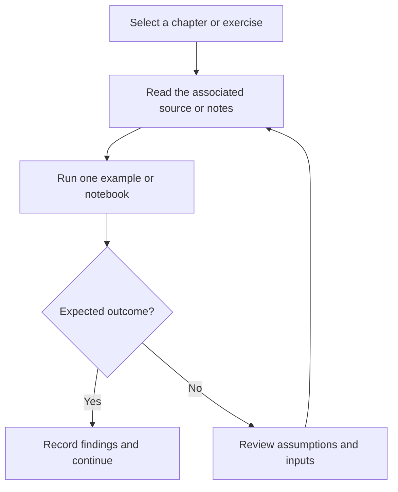

# OCI AI Foundations — Study Guide

Study materials and learning resources for Oracle Cloud Infrastructure AI Foundations concepts.

## Project focus

Learning notes and notebooks. Use the directory map to choose a focused example or learning topic instead of treating the repository as one application.

## Workflow



The diagram describes how to work through the material; it is not a deployed service topology.

## Repository structure

| Path | Purpose |
| --- | --- |
| [`1 - AI Foundations/`](1%20-%20AI%20Foundations) | Topic-organized learning material and examples. |
| [`2 - Machine Learning Foundations/`](2%20-%20Machine%20Learning%20Foundations) | Topic-organized learning material and examples. |
| [`3 - Deep Learning Foundations/`](3%20-%20Deep%20Learning%20Foundations) | Topic-organized learning material and examples. |
| [`4 - Generative AI and LLM Foundations/`](4%20-%20Generative%20AI%20and%20LLM%20Foundations) | Topic-organized learning material and examples. |
| [`5 - OCI AI Portfolio/`](5%20-%20OCI%20AI%20Portfolio) | Topic-organized learning material and examples. |
| [`6 - OCI Generative AI Service/`](6%20-%20OCI%20Generative%20AI%20Service) | Topic-organized learning material and examples. |
| [`7 - OCI AI Services/`](7%20-%20OCI%20AI%20Services) | Topic-organized learning material and examples. |
| [`Books/`](Books) | Project-specific source, resources, or learning material. |
| [`requirements.txt`](requirements.txt) | Python dependency manifest. |

## Getting started

```bash
git clone https://github.com/Raimal-Raja/Certified-Oracle-Cloud-Infrastructure-AI-Foundations-Associate.git
cd Certified-Oracle-Cloud-Infrastructure-AI-Foundations-Associate
```

```bash
python -m venv .venv
source .venv/bin/activate
```

On Windows PowerShell, activate the environment with `.venv\Scripts\Activate.ps1` instead.

```bash
python -m pip install -r requirements.txt
```

Open one `.ipynb` file in Jupyter, VS Code, Kaggle, or Colab. Read its dependency and dataset cells before execution. Notebook paths and model/data requirements vary; this repository is not one shared deployable application.

## Verification

Use the setup commands and inspect the selected interface, example, or notebook with known inputs. This documentation review checks repository paths and dependency declarations; it does not claim fresh end-to-end execution or model-quality measurements.

## Detailed project guide

The **Oracle Cloud Infrastructure (OCI) AI Foundations Learning Path** introduces you to the **fundamental concepts of Artificial Intelligence (AI), Machine Learning (ML), Deep Learning (DL), and Generative AI** — with a strong focus on their **practical applications within Oracle Cloud Infrastructure (OCI)**.

This beginner-friendly course is ideal for individuals who want to understand how AI technologies work, how they’re applied in modern business contexts, and how to leverage **OCI AI services** to design intelligent solutions. No prior experience with AI, ML, or programming is required.

---

## 🎯 Course Overview

The **OCI AI Foundations Learning Path** consists of:

* 🧠 **OCI AI Foundations Course**
* 📝 **Online Certification Exam**
* 🧩 **Practice Exam**
* 📘 **Exam Preparation Lesson**

This structured learning path provides foundational knowledge and practical exposure to AI within OCI’s ecosystem.

---

## ⚙️ Prerequisites

* **None required** — no prior familiarity with AI or ML concepts.
* **No coding experience** is necessary to complete this course.

---

## 📘 Course Description

The **Oracle Cloud Infrastructure (OCI) AI Foundations Course** helps beginners understand AI and ML fundamentals, emphasizing **real-world implementation using OCI services**.

You will gain a broad understanding of the **AI landscape**, the **core principles of deep learning**, and the **impact of Generative AI** and **Large Language Models (LLMs)** in modern computing. The course introduces **OCI Generative AI Services**, **Oracle 23ai Vector Database**, and other **OCI AI Services** such as **Vision**, **Speech**, **Language**, and **Document Understanding** — all presented through a simple, engaging, and hands-on approach.

---

## 🧭 Learning Outcomes

After completing this course, you will be able to:

* 💡 **Describe** the fundamentals of **Generative AI** and **Large Language Models (LLMs)**.
* 🧬 **Differentiate** between **machine learning** and **deep learning** architectures.
* 🧱 **Explore** the **Oracle AI stack**, including **infrastructure**, **data**, **ML**, and **AI services**.
* 🧠 **Describe** OCI’s portfolio of **AI tools and Generative AI services**.
* 🔍 **Analyze** ML fundamentals, focusing on **supervised and unsupervised learning** techniques.
* 🧩 **Examine** deep learning models such as **CNNs**, **RNNs**, and **LSTMs**.
* 🤖 **Evaluate** the capabilities and applications of **Generative AI models** and **language frameworks**.
* 🔗 **Leverage** OCI AI Services, OCI ML Services, OCI Generative AI, **Oracle 23ai**, and **Oracle Select AI**.

---

## 🚀 Benefits to You

By completing the **OCI AI Foundations Learning Path**, you will:

* 🧭 **Distinguish** between **Artificial Intelligence**, **Machine Learning**, and **Deep Learning** and understand their business applications.
* ⚙️ **Learn** how to deploy **AI tools** to automate, enhance, and optimize business workflows.
* 💼 **Leverage OCI AI Services** to address complex business challenges with scalable AI-powered solutions.
* 🎯 **Gain proficiency** in choosing the right **OCI AI Service** for specific organizational needs.

---

## 🧠 Skills You Will Learn

### 🔹 Artificial Intelligence Fundamentals

* AI concepts and terminology
* Relationship between AI, ML, and DL
* Real-world applications and ethical considerations

### 🔹 Machine Learning & Deep Learning

* Supervised and unsupervised learning methods
* Overview of CNNs, RNNs, and LSTMs
* Understanding model evaluation and training basics

### 🔹 Generative AI & LLMs

* Core principles of Generative AI
* LLM architecture, prompt design, and language model applications
* Introduction to Oracle 23ai Vector Database and OCI Generative AI

### 🔹 OCI AI Ecosystem

* Overview of OCI AI and ML services
* Vision, Speech, Language, and Document Understanding APIs
* Oracle Select AI for enhanced data retrieval and analysis

---

## 📚 Course Resources & References

Here are official Oracle resources to deepen your learning:

* **Oracle Cloud Infrastructure (OCI) Official Site:**
  [http./project

* **OCI AI Services Documentation:**
  [http./project

* **OCI Generative AI Documentation:**
  [http./project

* **Oracle 23ai Database Overview:**
  [http./project

* **Oracle Learning Explorer – AI Foundations Path:**
  [http./project

* **OCI Hands-On Labs:**
  [http./project

---

## ☁️ Cloud Family

* **Cloud Platform:** Oracle Cloud Infrastructure (OCI)
* **Course Type:** Foundational Learning Path
* **Focus Area:** Artificial Intelligence, Machine Learning, Deep Learning, Generative AI

---

## 🏁 Conclusion

The **OCI AI Foundations Learning Path** is your gateway to understanding and applying **Artificial Intelligence in Oracle Cloud Infrastructure**. With its balance of conceptual clarity and practical exposure, this course prepares you to explore advanced AI technologies confidently — from **basic ML algorithms** to **Generative AI innovations**.

Take your first step toward becoming an AI professional with **Oracle Cloud Infrastructure**.

---

**© Oracle Cloud Infrastructure | AI Foundations Learning Path**

---

## Contributing

Include reproduction steps, the affected path, expected behavior, and the checks you ran. Keep credentials, generated environments, and unnecessary build artifacts out of commits.

## License

No top-level license file is currently tracked. Check reuse permissions with the repository owner.
